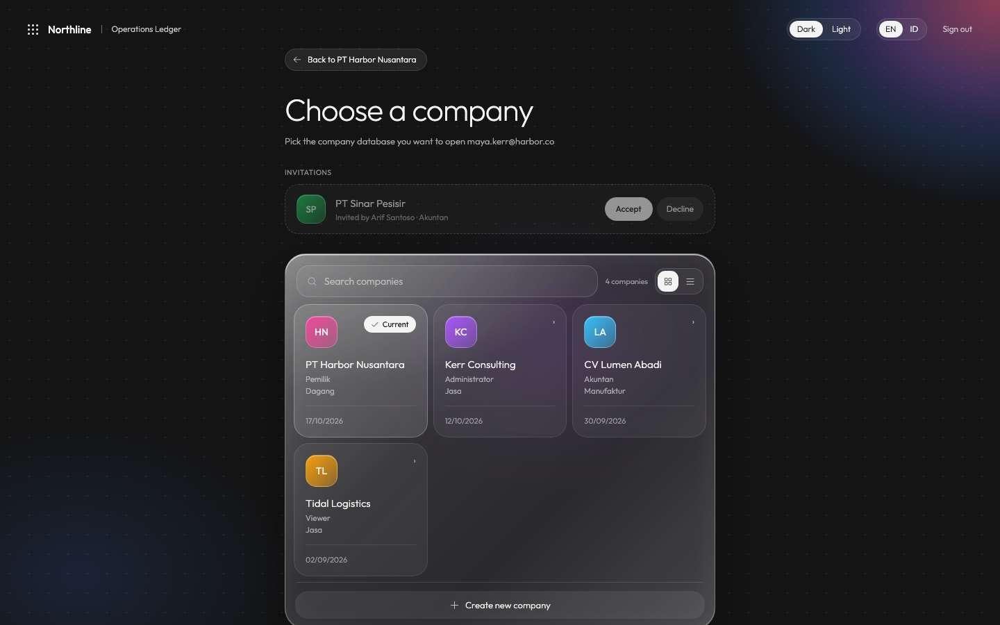
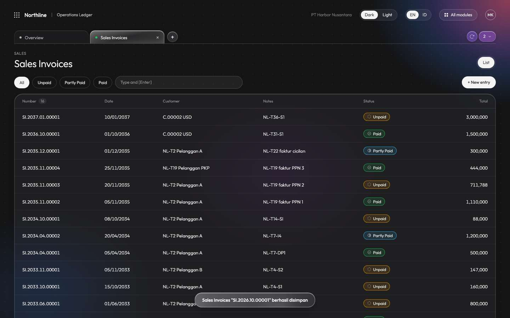
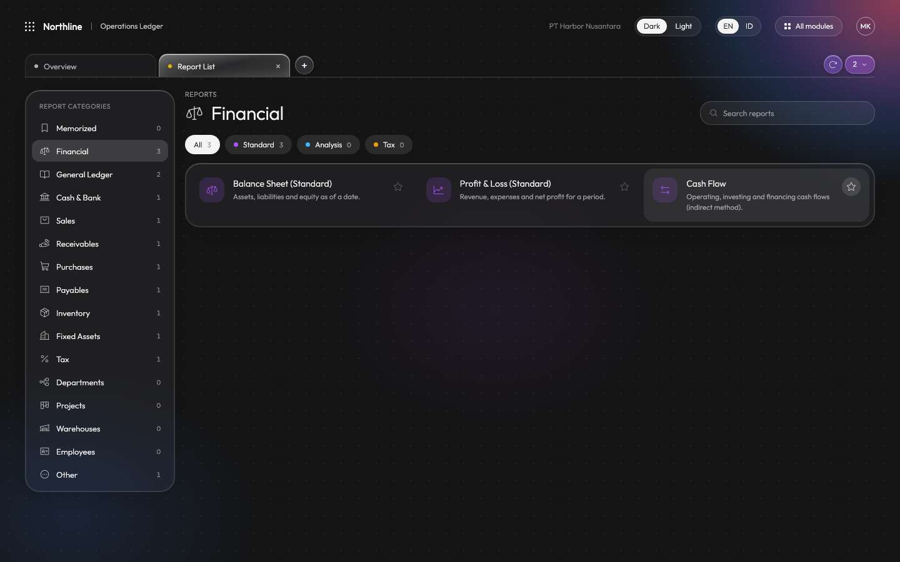
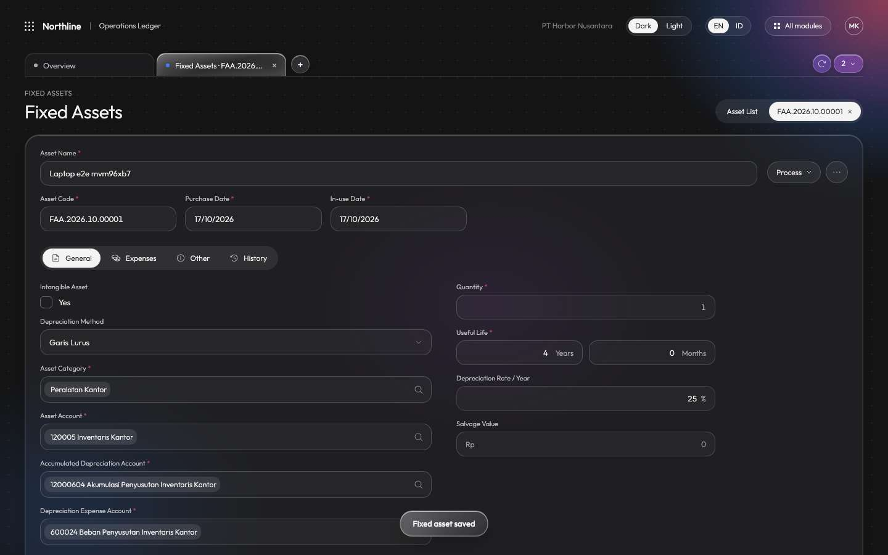
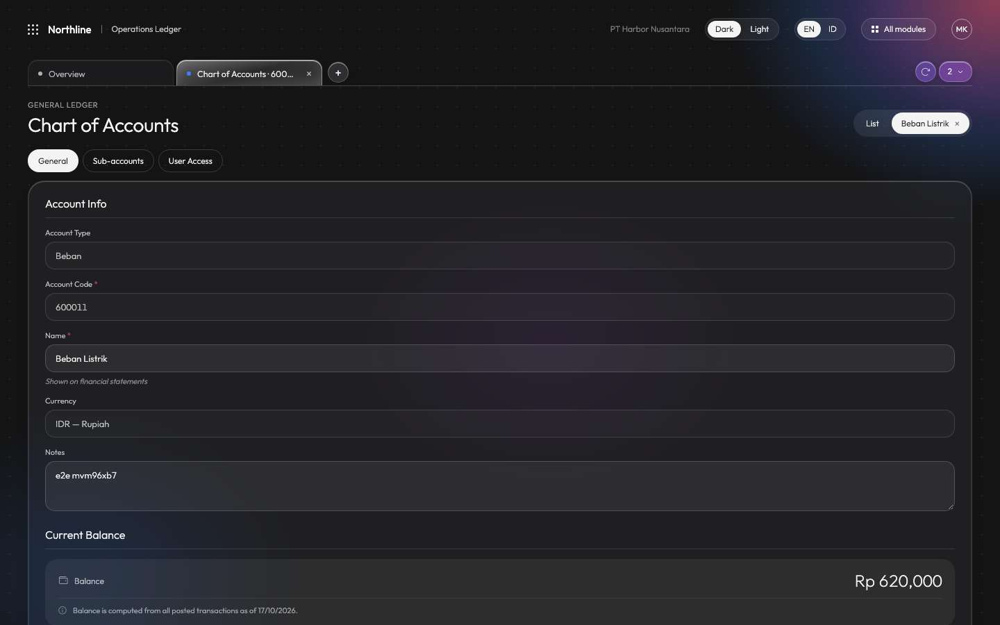

# strategy-loop verification evidence

Rendered by `bun loop` from [runs.jsonl](runs.jsonl), oldest first. In git: this page, runs.jsonl, results.json and
screenshots. Local only (gitignored): full logs and videos. The latest run of each kind keeps its files; older
failing runs keep their logs; failing steps keep their last lines below.

| Run | Stage | Kind | Code | Result | Time | Steps |
| --- | --- | --- | --- | --- | --- | --- |
| [20261024T090539-check](runs/20261024T090539-check/) | - | check | `a0ff8cd` | **FAIL** | 2m14s | migrations ✓ · mocks ✓ · coverage ✓ · parity ✓ · state ✓ · typecheck-api ✓ · typecheck-web ✓ · typecheck-loop ✓ · lint-web ✓ · test-api ✗ · test-web ✓ · test-loop ✓ |
| [20261024T090845-check](runs/20261024T090845-check/) | - | check | `55003f7` | **FAIL** | 42.4s | migrations ✓ · mocks ✓ · coverage ✓ · parity ✓ · state ✓ · typecheck-api ✓ · typecheck-web ✓ · typecheck-loop ✓ · lint-web ✓ · test-api ✗ · test-web ✓ · test-loop ✓ |
| 20261024T091030-check | - | check | `55003f7` | pass | 2m44s | migrations ✓ · mocks ✓ · coverage ✓ · parity ✓ · state ✓ · typecheck-api ✓ · typecheck-web ✓ · typecheck-loop ✓ · lint-web ✓ · test-api ✓ · test-web ✓ · test-loop ✓ |
| 20261024T091329-evals | - | evals | `55003f7` | pass | 10m6s | 25/25 ok |
| [20261024T094733-evals](runs/20261024T094733-evals/) | - | evals | `cb454f8` | **FAIL** | 10m23s | 26/27 ok |
| [20261024T100450-evals](runs/20261024T100450-evals/) | - | evals | `367f177` | **FAIL** | 2m7s | 13/27 ok |
| [20261024T100918-e2e](runs/20261024T100918-e2e/) | - | e2e | `b1bc113` | pass | 2m48s | db ✓ · seed ✓ · e2e ✓ · balance ✓ · access ✓ · done-when ✓ |
| 20261024T101808-check | - | check | `8d9d369` | pass | 1m27s | migrations ✓ · mocks ✓ · coverage ✓ · parity ✓ · state ✓ · typecheck-api ✓ · typecheck-web ✓ · typecheck-loop ✓ · lint-web ✓ · test-api ✓ · test-web ✓ · test-loop ✓ |
| [20261024T101954-evals](runs/20261024T101954-evals/) | - | evals | `8d9d369` | pass | 8m45s | 27/27 ok |
| [20261024T104606-check](runs/20261024T104606-check/) | - | check | `d5072f5` | **FAIL** | 32.0s | migrations ✓ · mocks ✓ · coverage ✓ · parity ✓ · state ✓ · typecheck-api ✓ · typecheck-web ✓ · typecheck-loop ✓ · lint-web ✓ · test-api ✗ · test-web ✓ · test-loop ✓ |
| 20261024T104740-check | - | check | `d5072f5` | pass | 1m23s | migrations ✓ · mocks ✓ · coverage ✓ · parity ✓ · state ✓ · typecheck-api ✓ · typecheck-web ✓ · typecheck-loop ✓ · lint-web ✓ · test-api ✓ · test-web ✓ · test-loop ✓ |
| [20261024T105246-check](runs/20261024T105246-check/) | - | check | `cfb6f0c` | pass | 1m20s | migrations ✓ · mocks ✓ · coverage ✓ · parity ✓ · state ✓ · typecheck-api ✓ · typecheck-web ✓ · typecheck-loop ✓ · lint-web ✓ · test-api ✓ · test-web ✓ · test-loop ✓ |

## Golden evals: 20261024T101954-evals on `8d9d369`

| Case | Run 1 | Run 2 | pass^k |
| --- | --- | --- | --- |
| G1 | pass | pass | ✓ |
| G2 | pass | pass | ✓ |
| G3 | pass | pass | ✓ |
| G4 | pass | pass | ✓ |
| G5 | pass | pass | ✓ |
| G6 | pass | pass | ✓ |
| G7 | pass | pass | ✓ |
| G8 | pass | pass | ✓ |
| G9 | pass | pass | ✓ |
| G10 | n/a | n/a | n/a |
| G11 | n/a | n/a | n/a |
| G12 | n/a | n/a | n/a |

## Failing steps (last lines of each log)

20261024T094733-evals · 2:test-api · 431 pass, 3 fail

```
      at addChunk (internal:streams/readable:267:47)
      at readableAddChunkPushByteMode (internal:streams/readable:245:18)
      at data (node:net:633:72)
test/parity-p4.test.ts:
(fail) Penerimaan Penjualan and Retur Penjualan: edit in place, Accurate's journals, no lines refused, delete; the invoice can go afterwards [20238.31ms]
  ^ this test timed out after 20000ms.
(fail) Pencatatan Gaji: EPY number, Dr fee expenses / Cr PPh 21 / Cr salary payable (TER), edit in place, no employees refused, delete [20106.12ms]
  ^ this test timed out after 20000ms.
(fail) Proses Akhir Bulan: no month refused with Accurate's text; edit keeps the number, delete frees the period [20001.36ms]
  ^ this test timed out after 20000ms.
 431 pass
 3 fail
 1646 expect() calls
Ran 434 tests across 48 files. [160.54s]
exit 1
```

20261024T100450-evals · 1:test-api · 69 pass, 78 fail

```
21 |   for (const v of t3.vendors) await upsertVendor(f.db, v)
22 |   for (const i of t4.items) await upsertItem(f.db, i as any)
23 |   await createReceiveItem(f.db, t24.receipt)
24 |   await catchUp(f.db, ledgerProjection)
25 | })
26 | afterAll(() => f.close())
                    ^
TypeError: undefined is not an object (evaluating 'f.close')
      at <anonymous> (/Users/dhiazfathra/Documents/GitHub/dhiazfathra/northline-loop/apps/api/test/purchases-2036.test.ts:26:16)
(fail) (unnamed) [0.25ms]
 69 pass
 78 fail
 161 expect() calls
Ran 147 tests across 48 files. [26.03s]
exit 1
```

20261024T100450-evals · 1:db · Postgres at localhost:55432 is not up: start it with `bun run dev:db`

```
$ bun apps/api/scripts/e2e-db.ts reset  (in .)
Postgres at localhost:55432 is not up: start it with `bun run dev:db`
exit 1
```

20261024T100450-evals · 2:db · Postgres at localhost:55432 is not up: start it with `bun run dev:db`

```
$ bun apps/api/scripts/e2e-db.ts reset  (in .)
Postgres at localhost:55432 is not up: start it with `bun run dev:db`
exit 1
```

## Latest e2e: 20261024T101954-evals on `8d9d369` (run-1 114/114, run-2 114/114 flows pass)

No failures.

| Flow | Result | Screenshot | Video |
| --- | --- | --- | --- |
| sign in | pass |  | local: `runs/20261024T101954-evals/run-2/n1-flows/videos/sign-in.webm` |
| [G6] doc form add item + save (sales invoice) | pass |  | local: `runs/20261024T101954-evals/run-2/n1-flows/videos/g6-doc-form-add-item-save-sales-invoice.webm` |
| [G3] report star toggles and persists across reload | pass |  | local: `runs/20261024T101954-evals/run-2/n1-flows/videos/g3-report-star-toggles-and-persists-across-reload.webm` |
| [G6] fixed-asset validation + create | pass |  | local: `runs/20261024T101954-evals/run-2/n1-flows/videos/g6-fixed-asset-validation-create.webm` |
| [G3] account row → form (+ save details) | pass |  | local: `runs/20261024T101954-evals/run-2/n1-flows/videos/g3-account-row-form-save-details.webm` |
